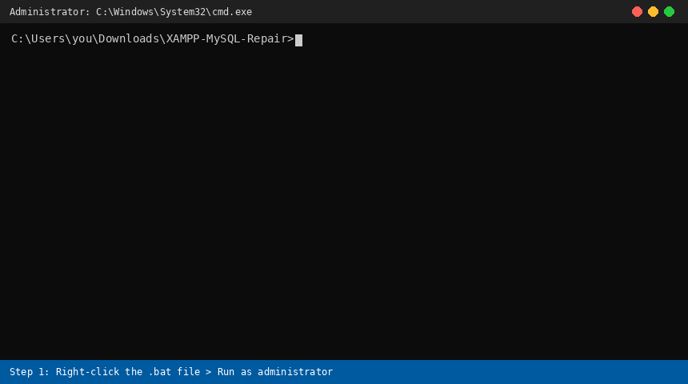

# XAMPP MySQL Repair

 

One-click Windows script that fixes the common **"MySQL won't start / already running / InnoDB crash recovery"** errors in XAMPP, **without losing your databases**.



> The demo above is an animated illustration of the script's console output (full repair, option 2).

---

## Why does this happen?

Force-ending XAMPP from Task Manager (or shutting down Windows abruptly) kills MySQL mid-write. Its InnoDB log files are left inconsistent, so the next start fails.

## What's inside

```
XAMPP-MySQL-Repair/
├── fix_xampp_mysql.bat   <- the repair script
├── README.md
├── LICENSE
├── .gitattributes
└── assets/
    └── demo.gif
```

## How to use

1. **Close** the XAMPP Control Panel (use **Quit**, not Task Manager).
2. Right-click `fix_xampp_mysql.bat` → **Run as administrator**.
3. Choose an option:

| Option | What it does | When to use |
|---|---|---|
| **1 – Quick fix** | Deletes `ib_logfile0`, `ib_logfile1`, `aria_log.*` | Try this first |
| **2 – Full repair** | Rebuilds the `data` folder from XAMPP's `backup`, then restores your databases and `ibdata1` | If option 1 didn't help |

4. Open XAMPP Control Panel and click **Start** on MySQL.

## What the script does (in order)

1. Checks it is running as Administrator.
2. Kills any leftover `mysqld.exe`.
3. **Makes a safety copy** of your data → `C:\xampp\mysql_data_safety_copy_<timestamp>`
4. *Option 1:* deletes the log files.
   *Option 2:* renames `data` → `data_old_<timestamp>`, copies `mysql\backup` → new `data`, then copies back your own database folders and `ibdata1`.
   The system folders `mysql`, `performance_schema`, `phpmyadmin`, `sys` and `test` are **not** copied from the old data.

## Good to know

- XAMPP installed elsewhere? Edit this line at the top of the script:
  `set "XAMPP=C:\xampp"`
- Delete the safety copy and `data_old_...` folders only after you confirm your databases open fine in phpMyAdmin.
- This repairs damage; it doesn't prevent it. Always **Stop** Apache/MySQL, then **Quit** the Control Panel, and shut Windows down normally.
- Still failing? Check `C:\xampp\mysql\data\mysql_error.log` for the exact error.

## Disclaimer

This script renames and deletes files inside your XAMPP MySQL folder. It always makes a safety copy first, but you use it **at your own risk**. Back up `C:\xampp\mysql\data` yourself if your databases are important.

## About

Built with AI assistance (Claude) and tested by the author on XAMPP for Windows.

## License

Released under the [MIT License](LICENSE).
